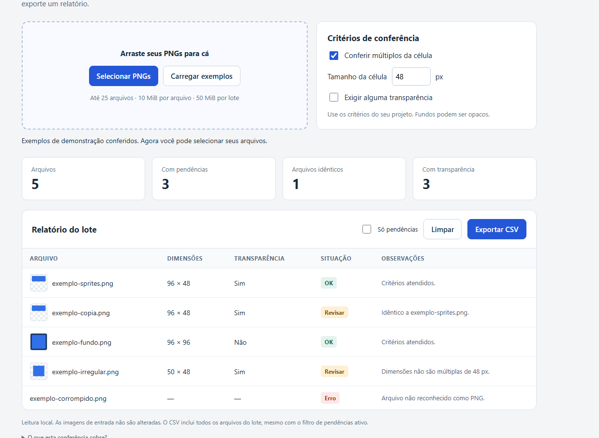

# Conferidor PNG

Ferramenta local para conferir pacotes de PNGs estáticos usados em projetos 2D. Reúne dimensões, presença de transparência, duplicatas exatas e regras de grade em uma tabela, com exportação CSV.



## Usar

1. Baixe este repositório pelo botão **Code → Download ZIP** e extraia os arquivos.
2. Abra `conferidor-png.html` no navegador. O aplicativo não exige servidor, bibliotecas ou instalação.
3. Clique em **Carregar exemplos** ou selecione seus PNGs. Ajuste os critérios e use **Exportar CSV** para baixar o relatório.

O código processa as imagens no navegador, sem enviá-las a serviços externos ou alterar os arquivos originais. A interface é em português do Brasil.

## Recursos

- Dimensões e presença de pixels com transparência.
- Duplicatas com conteúdo idêntico byte a byte.
- Conferência opcional de dimensões múltiplas de uma célula configurável.
- Exigência opcional de transparência; fundos podem ser opacos.
- Filtro de pendências e relatório CSV do lote completo.
- Erros de leitura registrados por arquivo.

## Limites

Até 25 arquivos por lote, 10 MiB por arquivo, 50 MiB por lote e 16.777.216 pixels por imagem. Aceita PNG estático; não aceita APNG.

A ferramenta não corrige imagens, não compara semelhança visual e não certifica compatibilidade com motores de jogos. Uma nova seleção válida substitui o lote anterior.

O CSV usa UTF-8 com BOM, ponto e vírgula e campos entre aspas. Nomes iniciados por `=`, `+`, `-`, `@` ou espaços seguidos desses caracteres recebem um apóstrofo de proteção contra fórmulas. Isso pode aparecer em leitores CSV e não modifica o nome original da imagem. `exemplo-relatorio.csv` contém a saída dos cinco exemplos da captura.

## Verificações

Os 16 testes das funções JavaScript usam somente módulos nativos do Node.js:

```sh
node testes.cjs
```

Eles cobrem dimensões conhecidas, entrada inválida, IEND ausente/inválido, bytes iguais/diferentes, excesso de pixels, APNG, critérios, CSV e ausência de dependências de rede conhecidas no HTML. As imagens sintéticas estão codificadas em `fixtures.json`; nenhum recurso de terceiros é necessário.

Abertura local, exemplos, filtro, limpeza e download foram conferidos manualmente pelo usuário. O CSV efetivamente baixado foi validado por script independente. O usuário também relatou funcionamento aparente de seleção, arraste e alteração dos critérios. A captura mostra os cinco exemplos: **5 arquivos, 3 pendências, 1 idêntico e 3 com transparência**.

Essas evidências não estabelecem compatibilidade com outros navegadores, celulares, arquivos nos limites máximos ou abertura do CSV no Excel. Os testes automatizados cobrem funções; não automatizam a interface.

## Sobre o projeto

Projeto experimental desenvolvido com assistência de IA, revisão estática independente e verificações automatizadas e manuais descritas acima.
